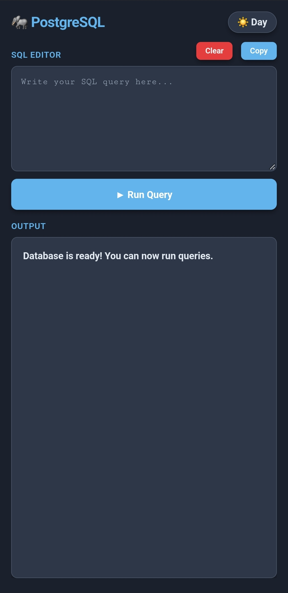

# 🐘 Postgres Practice: a pocket SQL IDE for Android

Practice real **PostgreSQL** on your phone, completely **offline**. No PC, no server, no internet.

I'm learning data engineering and wanted to practice SQL anywhere, not only at my desk. So I built my own mobile SQL IDE that runs an actual PostgreSQL engine on the device.

> **Note:** This repository is a showcase. It contains the README and screenshots only. The app itself is not public.

---

## 📱 Screenshots

<p align="center">
  
  
</p>
<p align="center"><sub>Light mode and dark mode</sub></p>

<p align="center">
  
  
</p>
<p align="center"><sub>Ready to use, and creating a table with data</sub></p>

<p align="center">
  
  
</p>
<p align="center"><sub>An aggregate query, and the <code>\dt</code> shortcut</sub></p>

---

## ✨ Features

### Real PostgreSQL, on your phone
- Runs **PGlite** (PostgreSQL compiled to WebAssembly) inside an Android WebView
- 100% offline and serverless: it connects to no external servers
- Full SQL support: `CREATE`, `DROP`, `INSERT`, `UPDATE`, `DELETE`, `JOIN`, subqueries, aggregates, window functions, CTEs (`WITH`) and constraints
- **Persistent storage:** tables, rows and schemas are saved on the device (IndexedDB) and are still there after closing the app or restarting the phone

### Accurate results
- Reads results in raw array mode, so queries like `SELECT COUNT(*), COUNT(salary)` show **both** columns, even when the names match
- Dates and timestamps display exactly as stored (`YYYY-MM-DD`, `YYYY-MM-DD HH:MM:SS`), with **no timezone shifting**
- Column headers keep the exact casing from the database
- `NULL` values show as faded `null`, and JSON and array values are safely displayed as text

### Clean mobile interface
- **Day and night themes:** follows the system theme on first launch and remembers your choice
- Smart editor: monospace font, spellcheck off (no red squiggles under SQL keywords), expandable height
- Scrollable result tables with a sticky header and alternating row colors

### psql shortcuts
- **`\dt`**: lists the tables in your database and their owners
- **`\c`**: reminds you that you're already connected locally
- **Other `\` commands**: explains that they're unsupported and suggests standard SQL

### Copy and share
- **Copy:** copies your query to the clipboard in one tap
- **Clear:** empties the editor and refocuses the keyboard
- **Copy Data:** turns the results into a neatly aligned plain-text table that stays formatted when pasted into WhatsApp, Slack, Notes or email

```
emp_id | name | department | salary
-------|------|------------|----------
1      | Ali  | IT         | 60000.00
2      | Sara | HR         | 48000.00
```

---

## 🛠️ Tech stack

- **Database engine:** PGlite (PostgreSQL in WebAssembly)
- **Frontend:** HTML, CSS and JavaScript, bundled with Vite
- **Native wrapper:** Capacitor and Android WebView
- **Build:** Android Gradle, compiled on-device with Termux
- **Storage:** IndexedDB (`idb://postgres-practice-db`)

---

## 🎯 Why I built it

- To practice `SELECT`, `WHERE`, `GROUP BY`, `HAVING`, aggregates and more whenever I have a few spare minutes
- To learn how WebAssembly, Capacitor and Android builds fit together
- To prove that you can build a real developer tool entirely from a phone

---

## 👤 Author

**Soumyadip Ghosh**
Learning data engineering: Python, SQL and ETL.

[](https://www.linkedin.com/in/samdip)
[](https://github.com/rotten-repo)

Feedback and ideas are welcome. Open an issue or message me on LinkedIn.
